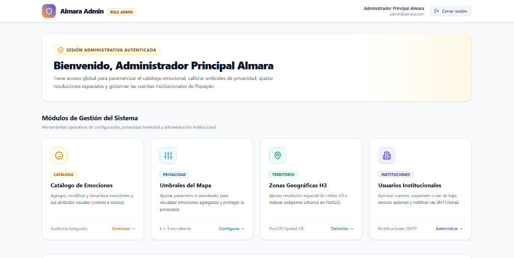
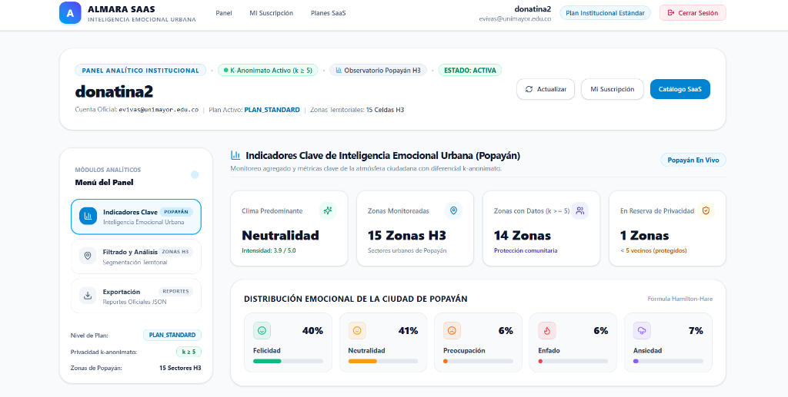

# Almara — Frontend (`almara-frontend`)

Interfaces de usuario del ecosistema **Almara (Inteligencia Emocional Urbana)**.

El proyecto está organizado en dos aplicaciones independientes según la audiencia y el dispositivo:

```
almara-frontend/
├── web/    # Portal Web SPA (React + TypeScript + Vite + Tailwind CSS + Lucide Icons)
└── app/    # Aplicación Móvil Ciudadana (React Native + Expo + Lucide Icons + Leaflet)
```

---

## Paneles del Sistema por Rol

### 1. Panel de Administración (`web`)
Espacio exclusivo para administradores del sistema. Permite agregar o editar emociones del catálogo con íconos vectoriales normalizados de Lucide, calibrar umbrales de privacidad comunitaria y supervisar las instituciones registradas.



### 2. Panel de Cliente Institucional (`web`)
Plataforma SaaS para entidades públicas y privadas (alcaldías, universidades, gremios). Cuenta con un menú lateral que agrupa los **Indicadores Clave de Popayán**, el **Filtrado y Análisis por Zonas Territoriales** y la **Exportación de Reportes Oficiales**. También incluye el catálogo de planes y la gestión de suscripciones.



### 3. Aplicación y Explorador Ciudadano (`app`)
Permite a la ciudadanía registrar su estado de ánimo en segundos (sin iniciar sesión ni exponer datos personales), indicar intensidad, agregar comentarios y visualizar el mapa emocional en tiempo real.


---

## Requisitos Previos

- **Node.js**: Versión 18.x o 20.x LTS.
- **pnpm**: Gestor de paquetes oficial del proyecto.
  ```bash
  corepack enable
  corepack prepare pnpm@latest --activate
  ```
- **Backend Almara**: En ejecución en `http://localhost:8080` (ver guía en `almara-backend`).

---

## Guía de Configuración y Puesta en Marcha

### 1. Portal Web (`almara-frontend/web`)
Contiene los módulos para **Administradores** y **Clientes Institucionales**.

```bash
# Ingresar al directorio del portal web
cd almara-frontend/web

# Instalar dependencias con pnpm
pnpm install

# Iniciar servidor de desarrollo
pnpm dev
```

La aplicación web quedará disponible en: **`http://localhost:5173`**.

---

### 2. Aplicación Móvil Ciudadana (`almara-frontend/app`)
Contiene la experiencia para **Ciudadanos** (ingesta de emociones y mapa en vivo).

```bash
# Ingresar al directorio de la app móvil
cd almara-frontend/app

# Instalar dependencias con pnpm
pnpm install

# Iniciar el bundler de Expo
pnpm start
```

Desde la consola de Expo puede:
- Presionar **`w`** para abrir directamente en el navegador web (**`http://localhost:8081`**).
- Escanear el código QR con la aplicación **Expo Go** en su teléfono móvil (Android o iOS).

---

## URLs de Acceso por Perfil

### Rol Ciudadano (Ingesta de Emociones y Mapa en Vivo)
- **Ruta de acceso:** `http://localhost:8081` (o en dispositivo móvil con Expo Go).
- **Funcionalidad:**
  - Registro de emoción en un toque (Felicidad, Neutralidad, Preocupación, Enfado, Ansiedad).
  - Selector de intensidad (1 a 5) y comentario opcional.
  - Selección de zona o georreferenciación anónima.
  - Exploración del mapa interactivo de Popayán con actualización en vivo.

---

### Rol Cliente Institucional (Almara SaaS)
- **Registro de Nueva Entidad:** `http://localhost:5173/institutional/registro`
- **Inicio de Sesión:** `http://localhost:5173/institutional/login`
- **Panel Analítico Institucional:** `http://localhost:5173/institutional/dashboard`
  - *Indicadores Clave:* Clima predominante, intensidad media y distribución porcentual.
  - *Filtrado por Zonas:* Vista segmentada por sectores urbanos y estado de reserva.
  - *Exportación:* Generación de reportes analíticos oficiales en formato descargable.
- **Catálogo de Planes y Suscripción:** `http://localhost:5173/institutional/planes`
- **Estado de mi Suscripción:** `http://localhost:5173/institutional/mi-suscripcion`
- **Pasarela de Pago (Checkout):** `http://localhost:5173/institutional/checkout`

---

### Rol Administrador (Almara Admin)
- **Inicio de Sesión Admin:** `http://localhost:5173/admin/login`
- **Panel Principal de Control:** `http://localhost:5173/admin/dashboard`
- **Catálogo de Emociones:** `http://localhost:5173/admin/emociones` (gestión de emociones, colores e íconos Lucide).
- **Calibración de Umbrales:** `http://localhost:5173/admin/umbrales` (ajuste del parámetro de privacidad comunitaria).
- **Zonas Geográficas:** `http://localhost:5173/admin/zonas-h3` (delimitación territorial de la ciudad).
- **Gestión Institucional:** `http://localhost:5173/admin/instituciones` (aprobación y control de entidades registradas).

> **Credenciales de Administrador:**
> - Correo: `admin@almara.com`
> - Contraseña: `AdminAlmara2026!`
